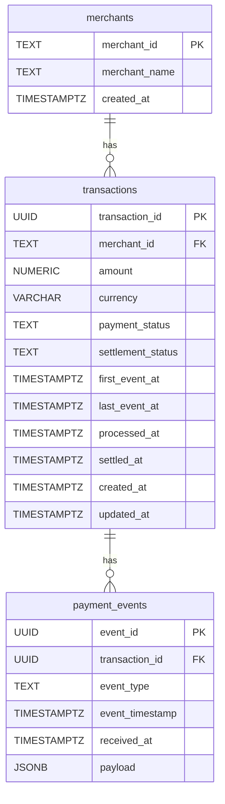

# Payment Reconciliation Service

## 1. Open and test the project

**No installation is needed to try the deployed API.**

1. Open the [live demo (Swagger UI)](https://setu-payment-reconciliation-xn99.onrender.com/docs).
2. **Please allow around one minute or longer for the first request after inactivity.** Render's free service sleeps when unused. Wait for it to wake, then retry if needed; later requests should be faster.
3. Expand `GET /health`, click **Try it out → Execute**, and check for `{"status":"ok"}`.
4. Try `GET /transactions` to see sample transactions. Copy a transaction ID into `GET /transactions/{transaction_id}` to see its history.
5. Try the two reconciliation endpoints for summaries and transactions needing investigation.

[Render](https://render.com/) is the cloud hosting platform running the API and PostgreSQL database.

**Postman:** import [collection.json](postman/collection.json) and [render.environment.json](postman/render.environment.json), select **Setu — Render**, and run the collection in order. See the [short Postman instructions](postman/README.md).

The supplied dataset contains **3,800 transactions and 10,165 unique events** across five merchants. Demo/test requests add records, so live totals can be higher.

## 2. Database schema



| Table | Purpose |
| --- | --- |
| `merchants` | Merchant ID and name. |
| `transactions` | One current-state row per transaction, linked to its merchant. |
| `payment_events` | Accepted event history, linked to its transaction. |

Payment status and settlement status are separate: a processed payment can still be awaiting settlement. `processed_at` and `settled_at` are null until the corresponding events exist. Event timestamps describe when events occurred; received/created timestamps describe when they were stored.

Primary keys prevent duplicate IDs; foreign keys preserve relationships. Indexes support merchant/status/date filtering, event-history lookup, and processed payments awaiting settlement. Full definitions: [001_initial.sql](migrations/001_initial.sql).

## 3. Architecture

```text
Swagger / Postman → FastAPI routes → Services → SQLAlchemy repositories → PostgreSQL
```

- `app/routes/`: HTTP endpoints and responses.
- `app/services/`: business rules and database transactions.
- `app/repositories/`: database queries.
- `app/schemas.py`: request/response validation; `app/models.py`: database mappings.
- `app/database.py`: connection pool and request sessions.

Event ingestion and current-state updates commit together or roll back together. Locks protect concurrent requests. State is calculated from accepted history, so out-of-order events are supported.

## 4. API reference

The [interactive documentation](https://setu-payment-reconciliation-xn99.onrender.com/docs) contains every field, filter, and response schema.

| Endpoint | Purpose / useful inputs |
| --- | --- |
| `GET /health` | Check database connectivity. |
| `POST /events` | Accept `payment_initiated`, `payment_processed`, `payment_failed`, or `settled`. |
| `GET /transactions` | Current states; filter by `merchant_id`, `status`, `settlement_status`, `date_from`, `date_to`; supports `page`, `page_size`, `sort_by`, `sort_order`. |
| `GET /transactions/{transaction_id}` | Current state and accepted event history; 404 if not found. |
| `GET /reconciliation/summary` | Group by `merchant`, `date`, or `status`; currencies stay separate. |
| `GET /reconciliation/discrepancies` | Flagged transactions with reasons; optional `reason` and `as_of`. |

Both reports support merchant/date filters and pagination. Default page size is 20, maximum 100. Date filters use the first event timestamp: start inclusive, end exclusive. Summary `total` counts groups, not transactions.

Example body for `POST /events` (use fresh UUIDs for new demo records):

```json
{
  "event_id": "711a8f3f-71a4-44cb-bf21-2d4221909edb",
  "transaction_id": "6251a96d-9667-4ff2-aa08-cf89e11b1e68",
  "event_type": "payment_processed",
  "merchant_id": "demo_merchant",
  "merchant_name": "Demo Store",
  "amount": "100.00",
  "currency": "INR",
  "timestamp": "2026-10-28T10:00:00Z"
}
```

- New event: **201**. Identical retry: **200**, `duplicate: true`, no extra event.
- Same event ID with different data, or changed transaction merchant/amount/currency: **409**.
- Invalid input: **422**. Temporary database unavailability: **503**.
- For another lifecycle event, keep the transaction details and use a new event ID.

| Discrepancy reason | Meaning |
| --- | --- |
| `overdue_settlement` | Processed and unsettled for longer than the grace period. |
| `settled_failed_payment` | Settled despite failed or conflicting payment state. |
| `conflicting_payment_events` | Both processed and failed events exist. |
| `settlement_without_processed_payment` | Settled without a processed or failed event yet. |

A failed payment alone is not a discrepancy. A transaction can have multiple reasons. This service records reported events; it does not move money.

## 5. Run locally (optional)

### Option A: Docker

Install and start Docker, then:

```sh
git clone https://github.com/seriouslynonserious/payment-reconciliation.git
cd payment-reconciliation
docker compose up --build -d
docker compose logs -f api
```

Open http://localhost:8001/docs. The API starts before the initial sample import finishes; wait for the loader's final summary for the full dataset. Data persists in a Docker volume. Stop with `docker compose down`.

### Option B: Python and PostgreSQL

Install Python 3.13 and PostgreSQL 18. Clone the repository as above, then:

```sh
python3.13 -m venv .venv
source .venv/bin/activate
python -m pip install -r requirements.txt
cp .env.example .env
createdb -h localhost setu_reconciliation
```

On Windows, activate with `.venv\Scripts\activate`. Edit `DATABASE_URL` in `.env` to match your PostgreSQL username/password and database. Then, against this **fresh database**:

```sh
python -m scripts.migrate
python -m scripts.load_sample_data --once
uvicorn app.main:app --host 127.0.0.1 --port 8000
```

Open http://127.0.0.1:8000/docs. For Postman, select [local.environment.json](postman/local.environment.json). The migration runner intentionally refuses an existing unversioned schema; do not reinitialize the earlier manually created development database.

## 6. Deployment and tests

[render.yaml](render.yaml) defines the Docker API and PostgreSQL database on Render. To reproduce deployment, connect the GitHub repository using **New → Blueprint**, select `main`, review the free resources, and deploy. `DATABASE_URL` is supplied by Render; `LOAD_SAMPLE_DATA=true` enables the sample import. Startup applies migrations and skips an already completed import.

Free web services sleep after inactivity. Render's free PostgreSQL database expires after 30 days, so hosting must be maintained through the review period. See [Render free-service limits](https://render.com/docs/free).

Run tests against a local PostgreSQL database whose user can create schemas:

```sh
python -m pytest -q
```

Verified results: **77 automated tests passed**; the deployed Postman collection passed **26 requests and 57 assertions**. Tests use isolated schemas. Each Postman run adds four synthetic transactions and eight events.

## 7. Assumptions and tradeoffs

- Money uses exact two-decimal values; JSON responses represent amounts as strings. Currencies are validated as three uppercase letters, not against a full currency registry.
- Timestamps use UTC. Settlement grace defaults to 24 hours, configurable through `SETTLEMENT_GRACE_HOURS`.
- `as_of` changes the aging clock only; it does not reconstruct historical state.
- Processed plus failed events produce `conflict`. Settlement is recorded separately; contradictory reports are preserved for investigation.
- Summary settlement counts can overlap payment counts. Pending counts include payments still within grace; discrepancy totals can include other reasons.
- Offset pagination is simple for this dataset; cursor pagination would suit much larger datasets. Indexes add storage/write overhead.
- This is an unauthenticated demo for synthetic data, not a production payment system.

Sample data: [Setu assignment dataset](https://github.com/SetuHQ/hiring-assignments/blob/main/solutions-engineer/sample_events.json).

## AI assistance

I used ChatGPT and Codex to understand requirements, learn Python, assist with implementation and simplification, and improve tests and documentation.
